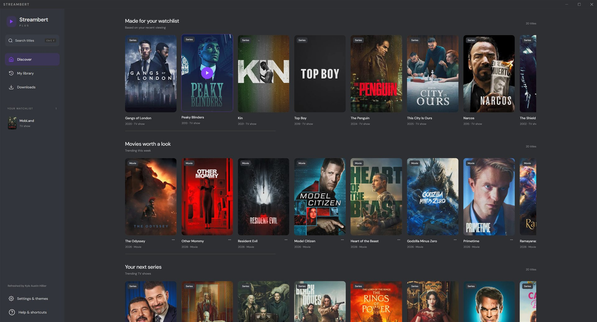
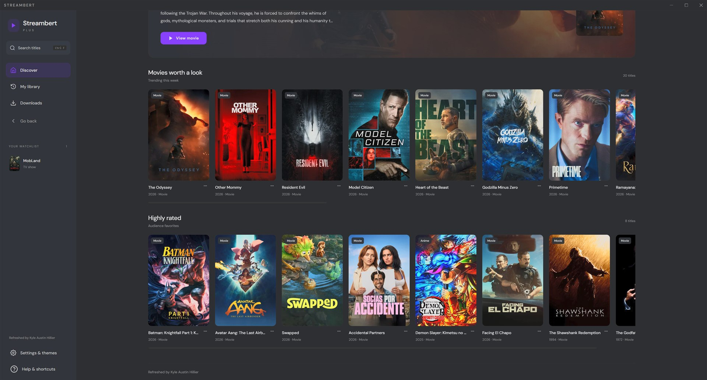
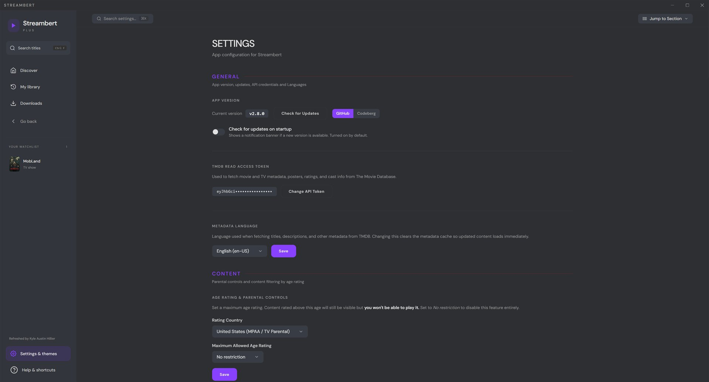
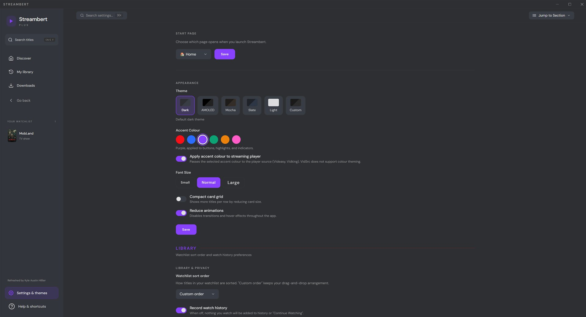
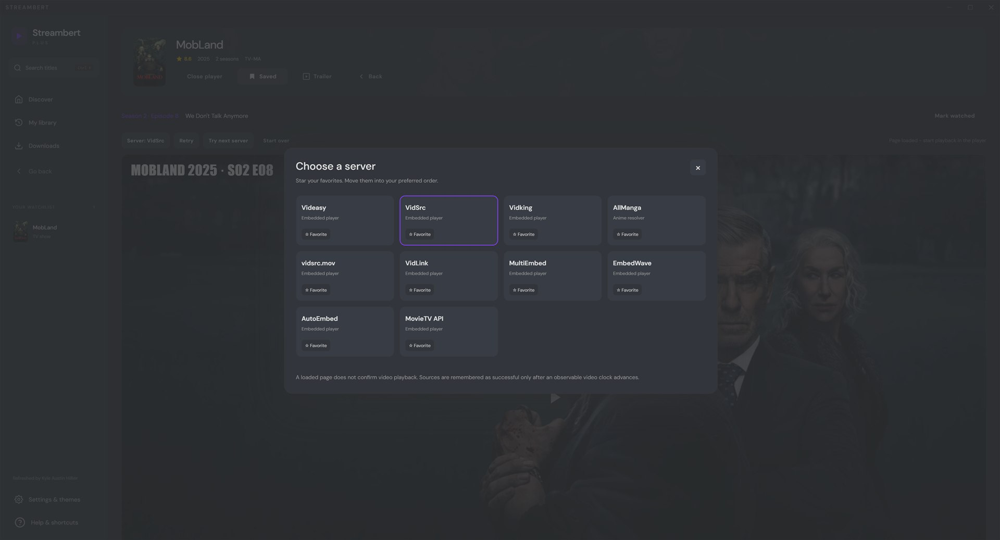
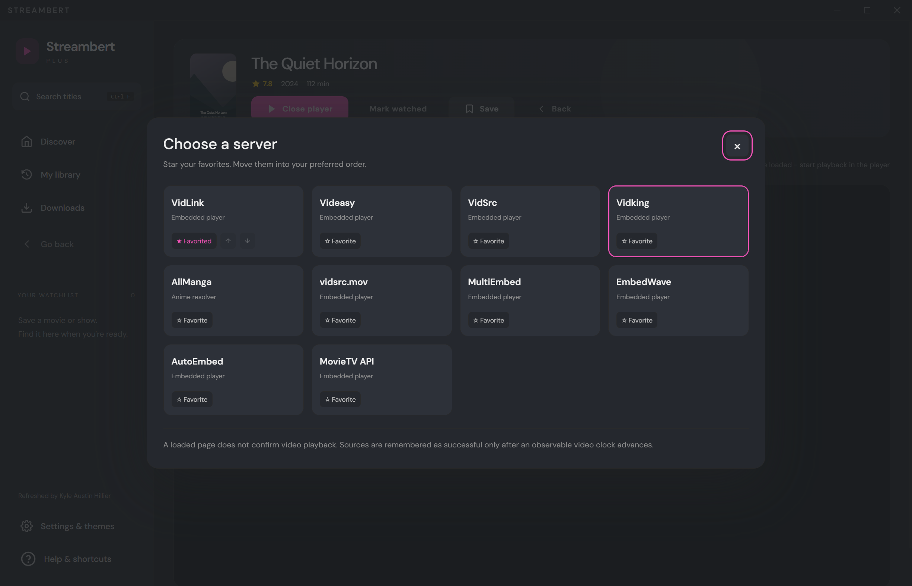
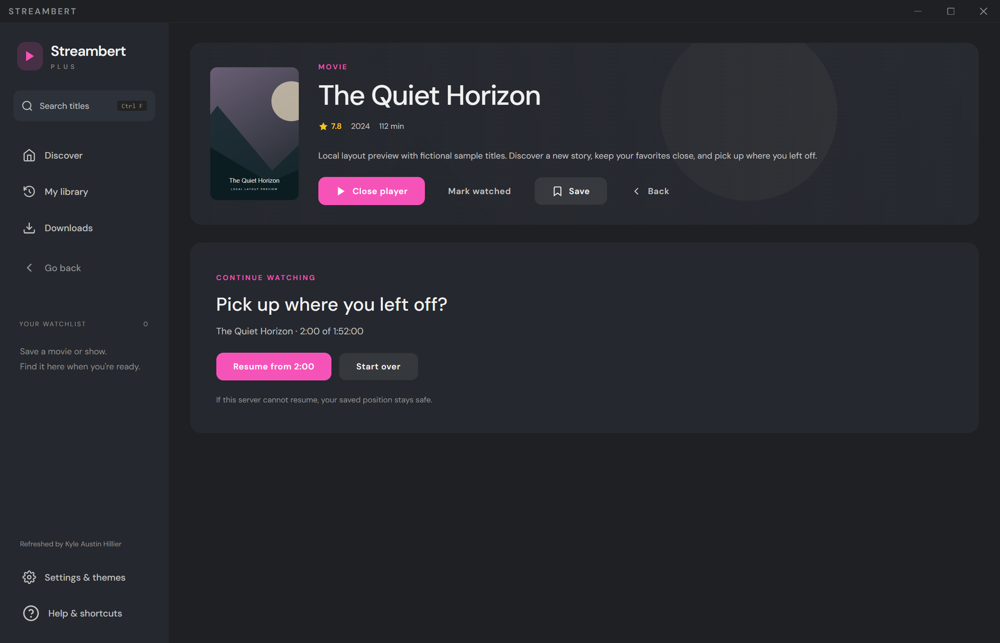

# Streambert Plus

**Refreshed by Kyle Austin Hillier.** A Windows desktop movie and TV browser with a clean layout, selectable color themes, favorite servers and guarded playback resume.

## Download the latest release

**Current release: [Streambert Plus 2.8.7](https://github.com/bubblegump30/streambertplus/releases/tag/v2.8.7).** This is a regular release, not a pre-release.

- [Download Windows x64 ZIP](https://github.com/bubblegump30/streambertplus/releases/download/v2.8.7/Streambert-Plus-2.8.7-Windows-x64.zip)
- [Download matching source code](https://github.com/bubblegump30/streambertplus/releases/download/v2.8.7/Streambert-Plus-2.8.7-Source.zip)
- [SHA-256 checksums](https://github.com/bubblegump30/streambertplus/releases/download/v2.8.7/SHA256.json)

Close Streambert Plus, extract the **entire Windows ZIP** into a folder, and launch **Streambert Plus.exe**. Keep its supporting files beside the executable. Plus versions share the same application profile; keep your existing profile when updating.

## 2.8.7 - AutoEmbed rotating-script protection

- Restrict third-party executable scripts on the exact AutoEmbed wrapper and observed player hosts, blocking rotating ad-loader domains absent from the bundled lists.
- Preserve first-party player scripts, required player libraries, media/subtitle requests and genuine verification scripts.
- Keep shared network, popup, navigation and cosmetic protections for the other sources.

Live NCIS S24E4 testing on AutoEmbed loaded a 42:28 video and, after seeking to 34:59, observed it advance to about 35:11 with no overlay visible. This is a brief seek-based sample, not a complete uninterrupted episode or a guarantee that all providers are ad-free. Genuine access-verification challenges are not bypassed. Provider changes can require further updates.

## 2.8.6 - MultiEmbed inline ad protection

- Filters HTTPS player-document responses from the exact streamingnow.mov host used by MultiEmbed.
- Removes identified inline advertising SDK scripts before they execute, preserving normal player and browser-verification scripts.
- Blocks the targeted response if filtering fails.
- Adds response-filtering, header-preservation and failure regression tests, plus dependency license notices.
- Includes the purple buttons with white text and the saved For you / Movies / TV shows startup preference from earlier releases.

**Verified for v2.8.6:** 26 automated tests and production builds passed on Windows and Linux in GitHub Actions. Packaged Windows ad-protection, playback/resume and layout fixtures passed. CodeQL passed with zero open code-scanning alerts at release time; the production dependency audit reported zero vulnerabilities. Uploaded ZIP integrity and SHA-256 checksums were checked.

**Live playback limitation:** NCIS S1E1 testing removed two identified inline ad scripts, but MultiEmbed stalled at its browser verification before video playback. Ad-free NCIS playback and complete live ad coverage across all providers remain unverified. Controlled fixture checks do not establish that every third-party advertisement is blocked.


## 2.8.5 - Code-scanning fixes

- Ad-test URL checks compare parsed hostnames instead of matching domain text anywhere in a URL.
- Stylesheets cross into guest frames as base64-encoded UTF-8 data, not JSON-derived executable source.
- DOM snapshots use a fixed script; page-controlled cached values are no longer interpolated into JavaScript.
- Security regression tests include injection-shaped strings, Unicode separators and lookalike domains.


## 2.8.4 - Discover startup tab

Settings > Start Page now includes For you, Movies and TV shows buttons. Selecting one saves automatically and sets the launch page to Discover. The next app launch opens that tab. The preference is included in backups. Existing Library and Downloads start-page choices remain available.


## 2.8.3 - Overlay protection and player buttons

- Pop out, External player, Download, Blocked and Mark season watched now have purple backgrounds and white text, including readable disabled states.
- Shared-session overlay, request and popup protection is applied to every server source.
- EmbedWave opens its documented Cinesrc backend by default instead of the Multi HD backend that attempted to inject an ad script in the investigation.
- Cosmetic filtering watches DOM changes throughout playback, including late frames and overlays that appear after the initial load.
- If a provider removes the ad stylesheet, the app restores it. Repeated scans skip unchanged documents and overlapping frame work.
- Popup blocking and the narrow redirect guard remain enabled.

A short Cinesrc movie sample showed an advancing clock. This does not guarantee an ad-free session for every title or backend. Verification challenges and playback controls are not removed generically.


## 2.8.2 - Provider compatibility update

- Retrying the current source or changing its audio mode reattaches player events and polling to the new guest instance.
- Retired Videasy and Vidking entries are clearly marked unavailable and skipped by defaults, remembered sources and next-server selection. Existing preferences are retained.
- VidLink is the fallback default for movies and TV; this does not guarantee its availability for every title.
- MultiEmbed's observed HTTPS redirect to streamingnow.mov is permitted. Arbitrary cross-origin takeovers and popups remain blocked.
- Video errors before duration metadata exists now reach the existing recovery controls instead of being discarded.

VidSrc, vidsrc.mov and MovieTV API remain available. Page-load probes alone do not prove playback; live full-stream acceptance remains unverified. Provider outages and missing titles cannot be repaired inside the app.


## 2.8.1 - Ad protection update

- Bundled EasyList network filtering and standard cosmetic rules, available offline.
- Filtering starts before the first embedded-player request.
- Popup windows and unsolicited cross-origin top-level navigation are blocked in embedded and pop-out players.
- Player frames receive cosmetic ad rules; media and subtitle detection stay on the same request handler.

The filter snapshot updates with app releases. Provider changes, inline promotions and ads stitched into the actual video may still need source-specific fixes. Real verification challenges are not solved or bypassed. Live verification of the reported provider overlay remains pending.

This fork preserves the original Streambert authorship and GPL-3.0 license. The Plus application was developed from the supplied Streambert 2.6.0 release; this repository also retains the upstream Git history. Upstream: https://github.com/truelockmc/streambert .

## 2.8.0 - Playback and resume

- Favorite and reorder servers. A title or episode can remember the last server on which a usable video clock actually advanced.
- Explicit **Resume / Start over** choice. A provider guest is not created until that decision is made when a bookmark exists.
- Exact-position bookmarks, remaining-time display, retry and next-server controls, and stalled-playback notices.
- Resume seeks are checked against an observable media element. If seeking fails, the old bookmark is kept until you explicitly choose **Continue from here**.
- Up Next with a cancellable countdown using your existing autoplay preferences.
- Optional VLC/mpv launch after a compatible direct stream has been detected. The player must be installed separately.
- One shared playback controller for movies and TV, with AllManga sub/dub resolution, episode mappings, trailers, downloads, pop-out playback and anime intro-skip hooks retained.
- New bookmarks, server preferences and color themes are included in backups. Clearing watch progress clears the new bookmarks too.

The clean Discover layout, library, watchlist, all ten provider options, color themes, and refresh credit from Plus 2.7.1 remain.

## Screenshots

Interface screenshots captured in Streambert Plus 2.8.0 with the purple accent theme. Version labels in these screenshots may differ from the current release.

### Discover and watchlist



### Movies and audience favorites



### General settings



### Themes and appearance



### Server selection



Screenshots show the interface; they do not verify playback availability for every provider or title.

<details>
<summary>Playback acceptance screenshots</summary>





These acceptance screenshots use fictional local test titles and a simulated media clock.

</details>

## Run or build

Use Node.js 24 (or a supported version meeting Vite's requirements).

```sh
npm ci
npm test
npm run build
npm start
```

Build a Windows folder package:

```sh
npm run package:win
```

The output is `release/win-unpacked`. Keep `Streambert Plus.exe`, `resources`, and the bundled DLLs together. The Windows package is unsigned. macOS/Linux package scripts are inherited, but this Plus release has only been packaged and tested locally on Windows.

On first launch, enter your own TMDB **API Read Access Token** in the app. The Plus profile is `%APPDATA%/Streambert Plus`; it is separate from upstream Streambert and is shared across Plus versions. Keep your credentials private. No user profile or real credential is committed here.

## Validation

```sh
npm test
npm run test:ui
npm run test:playback
npm run test:ads
```

The UI tests run Electron with an isolated profile, intercepted HTTPS responses and local metadata. The playback test uses a simulated video clock to check success detection and resume behavior. It does not play real external streams. Run them on a desktop-capable environment. CI runs unit tests and the frontend build on Windows and Ubuntu.

See [VALIDATION.md](VALIDATION.md), [PROVIDERS.md](PROVIDERS.md) and [PLUS-README.md](PLUS-README.md) for details.

## Practical limits

A loaded embed page is not proof that a video works. Progress and resume depend on the source exposing an observable, seekable video. Runtime checks help ignore short ads when metadata is available, but do not prove content identity. Real movie/TV provider playback, every subtitle service, external-player playback and full pop-out recovery still need live acceptance. External providers can change or fail independently of the app.

Upstream binary auto-installation is disabled so an upstream installer cannot replace this custom build. Download recovery preserves records and partial files; automatic byte-level resumption is not implemented.

## Credits

- Original Streambert: truelockmc and upstream contributors.
- Refreshed by Kyle Austin Hillier.
- GPL-3.0: see [LICENSE](LICENSE).
- This product uses the TMDB API but is not endorsed or certified by TMDB.

